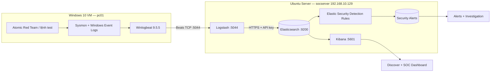

> **Một hành trình tự dựng SIEM thực tế trên laptop 16 GB RAM**  
> **Stack:** VMware Workstation · Ubuntu Server 24.04 LTS · Windows 10 · Elasticsearch/Kibana/Logstash 9.5.5 · Sysmon 15.22 · Winlogbeat 9.5.5 · Elastic Security · Atomic Red Team  
> **Thời gian thực hiện được ghi lại:** 18–20/10/2026; biên soạn ngày 21/10/2026.  
> **Mục tiêu:** Học cách một SOC thu thập telemetry, hiển thị Dashboard, phát hiện hành vi và kiểm chứng Security Alert trên môi trường được phép thử nghiệm.


*Ảnh 1 — Dashboard Kibana thực tế của lab. Ở thời điểm chụp ngày 19/10, hệ thống hiển thị **7.170 events**, phân bố Sysmon Event IDs, tiến trình và bảng sự kiện gần nhất. Số liệu trong ảnh là tại thời điểm chụp, không phải tổng cố định.*

## 1. Review thành quả trước: chúng ta đã làm được gì?

Không có ngân sách cho server riêng? Không sao. Từ một máy Windows có **16 GB RAM**, mình dựng hai máy ảo trong VMware: một máy Windows 10 đóng vai trò endpoint cần giám sát và một Ubuntu Server đóng vai trò SIEM. Sau nhiều lần cấu hình, kiểm tra và sửa lỗi, log trên endpoint đã đến Elasticsearch và hiển thị trên Kibana; sau đó mình xây thêm Detection Rules và dùng Atomic Red Team để kiểm thử.

**Các cột mốc đã xác nhận:**

| Hạng mục | Kết quả thực nghiệm |
|---|---|
| Thu thập sự kiện Windows | Sysmon + Winlogbeat trên `pc01` đã gửi log về máy SIEM |
| Pipeline SIEM | Logstash lắng nghe `192.168.10.129:5044`; ghi dữ liệu vào Elasticsearch qua HTTPS |
| Elasticsearch | Index `winlogbeat-2026.10.19` từng có **4.885 documents**, khoảng **4,6 MB** trong lần kiểm tra đầu |
| Dashboard | Hoàn thiện bố cục **5 panel**; ảnh ghi nhận **7.170 events** tại một thời điểm |
| Nguồn telemetry | Đã quan sát Sysmon Event ID `1` (Process Create), `22` (DNS Query), `11` (File Create) và các event khác |
| Detection Rules | Tạo rule tùy chỉnh dựa trên `winlogbeat-*`, gồm PowerShell EncodedCommand và rule Echo Test phục vụ debug |
| Security Alerts | Ở buổi tiếp theo (20/10), đã xác nhận **3 alert mức Medium** trên `pc01` từ các rule PowerShell; đây là kết quả đến **sau** giai đoạn ảnh debug 0 alert |
| Atomic Red Team | Đã cài module; bài thử **T1059.001-17** thành công, in `Hello, from PowerShell!`; đã thực hiện kiểm thử **T1082 — System Information Discovery** |
| Prevention / Response | **Chưa triển khai cơ chế tự động chặn hoặc cô lập endpoint** |

**Đáng chú ý:** SOC Lab này **đã có detection + alerting**, nhưng **chưa phải EDR/SOAR hoàn chỉnh**. Atomic Red Team là framework kiểm thử kỹ thuật MITRE ATT&CK, không đồng nghĩa chạy một mẫu mã độc thực tế.


*Ảnh 2 — Windows Event Logs được truy vấn và xem trong Discover. Điều quan trọng không phải chỉ nhìn thấy biểu đồ, mà còn có thể đi sâu vào `event.code`, `winlog.event_data.*`, process và command line.*

### Một bài học đắt giá

Lúc đầu, **Sysmon đã tạo log, Elasticsearch đã nhận log, Detection Rule báo `Succeeded`, nhưng Security Alerts vẫn là `0`**. Chúng ta phải phân biệt rất rõ: **log được thu thập ≠ hành vi được phát hiện ≠ hành động phản ứng đã xảy ra**. Phần cuối bài ghi lại quy trình debug và các kết quả đã xác minh sau đó.

---

## 2. Muốn có Dashboard và Alert như vậy, hãy cùng build từ đầu

Thay vì import sẵn một dashboard rồi chụp màn hình, mục tiêu của dự án là hiểu **từng bước dữ liệu đi từ Windows tới SIEM**:

1. Windows tạo hành vi → **Sysmon/Windows Event Log** ghi nhận sự kiện.
2. **Winlogbeat** đọc các event channel và chuyển tới Logstash.
3. **Logstash** nhận Beats tại TCP/5044, xác thực với Elasticsearch bằng API key.
4. **Elasticsearch** đánh index, lưu trữ và cho phép tìm kiếm theo field.
5. **Kibana** hiển thị Discover, Dashboard và vận hành Detection Rules.
6. **Atomic Red Team** tạo hành vi kiểm thử để xem rule có sinh cảnh báo hay không.

### 2.1. Các thành phần có nhiệm vụ gì?

| Công cụ | Nơi chạy | Vai trò |
|---|---|---|
| VMware Workstation Pro | Windows Host | Chạy hai máy ảo độc lập |
| Ubuntu Server 24.04 | `socserver` | Máy chủ SIEM |
| Elasticsearch 9.5.5 | Ubuntu | Lưu và truy vấn dữ liệu dạng document JSON |
| Logstash 9.5.5 | Ubuntu | Nhận Beats, xử lý/định tuyến sự kiện, ghi Elasticsearch |
| Kibana 9.5.5 | Ubuntu | Discover, ES\|QL, Dashboard, Elastic Security và Alerts |
| Windows 10 | `pc01` | Endpoint để thu thập telemetry, chạy kiểm thử |
| Sysmon 15.22 | Windows | Ghi các sự kiện chi tiết như process creation và DNS |
| SwiftOnSecurity Sysmon Config | Windows | Bộ quy tắc **ghi log/loại trừ log** cho Sysmon; **không phải SIEM Detection Rules** |
| Winlogbeat 9.5.5 | Windows | Chuyển Windows Event Log tới Logstash |
| Elastic Security Detection Rules | Kibana | Query theo lịch, tạo Security Alerts khi thỏa điều kiện |
| Invoke-AtomicRedTeam | Windows | Thực thi các bài atomic test để đo khả năng phát hiện |

### 2.2. Sơ đồ kiến trúc



> **Luồng mạng của lab:** Winlogbeat → Logstash tại `192.168.10.129:5044` là kết nối Beats TCP **chưa bật TLS**. Logstash → Elasticsearch tại `https://localhost:9200` **có TLS và API key**. Trình duyệt → Kibana tại `http://192.168.10.129:5601` đang là **HTTP**. Các điểm này chấp nhận được để học trong mạng Host-only cách ly, nhưng phải bảo vệ bằng TLS/xác thực/quy tắc mạng nếu triển khai thật.

### 2.3. Sơ đồ IP, cấu hình VM

| Thiết bị | Hệ điều hành | RAM VM | Hostname/IP |
|---|---|---:|---|
| Windows Host | Windows | **16 GB tổng** | Chạy VMware Workstation |
| SOC Server | Ubuntu Server 24.04 LTS | **8 GB** sau khi điều chỉnh | `socserver`, `192.168.10.129` |
| Monitored Endpoint | Windows 10 | **3 GB** | `pc01` |

Mạng VMware đã sử dụng **Host-only `192.168.10.0/24`** để các VM trao đổi log; **NAT `192.168.100.0/24`** phục vụ đường ra ngoài khi cần tải gói. Địa chỉ `192.168.10.129` là địa chỉ của Ubuntu trong lab **của mình**; khi tái dựng cần thay bằng IP máy bạn.

**Các cổng quan trọng:**

```text
Windows pc01                 Ubuntu socserver
  Winlogbeat  ----------->   Logstash 192.168.10.129:5044
                                   |
                                   v
                             Elasticsearch localhost:9200 (HTTPS)
                                   ^
                                   |
  Web browser  ----------->   Kibana 192.168.10.129:5601 (HTTP)
```

**Quy tắc trước các thay đổi lớn:** Tắt VM an toàn (`sudo shutdown -h now` đối với Ubuntu), tạo **VMware Snapshot**, đặt tên mô tả rõ thao tác sắp làm; chỉ tiếp tục khi đã có điểm khôi phục. Snapshot là điểm hoàn tác của lab, không thay thế backup độc lập.

---

## 3. Build phần Ubuntu: Elasticsearch → Kibana → Logstash

### 3.1. Chuẩn bị Ubuntu

Kiểm tra IP, tên máy, thời gian và kết nối:

```bash
hostname
ip -br a
ip route
timedatectl
free -h
ping -c 3 192.168.10.1  # Chỉ thay bằng gateway/đích thực tế nếu có
```

Cập nhật và chuẩn bị các công cụ:

```bash
sudo apt update
sudo apt install -y curl ca-certificates gnupg apt-transport-https
```

**Nguồn APT chính thức Elastic 9.x** (khối dưới là hướng dẫn tái dựng; các bản package vẫn nên được pin theo phiên bản dùng trong môi trường):

```bash
curl -fsSL https://artifacts.elastic.co/GPG-KEY-elasticsearch \
  | sudo gpg --dearmor -o /usr/share/keyrings/elasticsearch-keyring.gpg

echo "deb [signed-by=/usr/share/keyrings/elasticsearch-keyring.gpg] https://artifacts.elastic.co/packages/9.x/apt stable main" \
  | sudo tee /etc/apt/sources.list.d/elastic-9.x.list

sudo apt update
sudo apt install elasticsearch kibana logstash
```

> Trong lần triển khai được ghi lại, ba thành phần **Elasticsearch, Kibana và Logstash đều là 9.5.5**. Lệnh APT ở trên là trình tự cài từ repo 9.x để tham khảo/tái dựng; nếu repo đã phát hành phiên bản mới hơn, cần chủ động chọn đúng bản thay vì giả định nó luôn cài 9.5.5.

### 3.2. Elasticsearch — bộ máy lưu log

Khởi động, cho chạy cùng hệ thống:

```bash
sudo systemctl daemon-reload
sudo systemctl enable --now elasticsearch
sudo systemctl status elasticsearch --no-pager
```

Elastic 9 tự cấu hình bảo mật HTTPS trong quá trình cài lần đầu. Trên lab, **CA certificate** nằm tại:

```text
/etc/elasticsearch/certs/http_ca.crt
```

Kiểm tra Elasticsearch bằng chính chứng chỉ CA, dùng tài khoản `elastic` và **nhập mật khẩu khi được hỏi**, không đặt password trực tiếp trong tài liệu:

```bash
sudo curl --cacert /etc/elasticsearch/certs/http_ca.crt \
  -u elastic 'https://localhost:9200?pretty'
```

Không dùng `curl -k` để bỏ qua xác minh TLS nếu không cần. Mật khẩu `elastic`, API key và token enrollment tuyệt đối không commit lên GitHub.


*Ảnh 3 — Kibana hiển thị màn hình chào mừng sau quá trình enrollment và đăng nhập.*

### 3.3. Kibana — giao diện SIEM

Trên máy Ubuntu của lab, Kibana được cấu hình lắng nghe tại IP Host-only:

```bash
sudo nano /etc/kibana/kibana.yml
```

```yaml
server.host: "192.168.10.129"
```

Tạo enrollment token phía Elasticsearch (token có hạn, không lưu lại trong bài viết):

```bash
sudo /usr/share/elasticsearch/bin/elasticsearch-create-enrollment-token -s kibana
sudo systemctl enable --now kibana
sudo systemctl status kibana --no-pager
```

Mở trình duyệt Windows tại:

```text
http://192.168.10.129:5601
```

Điền enrollment token, hoàn thành verification code trên Ubuntu rồi đăng nhập. Nếu gặp lỗi, đọc log:

```bash
sudo journalctl -u kibana -n 80 --no-pager
```

### 3.4. Logstash — nhận dữ liệu tại cổng 5044

Vì Elasticsearch yêu cầu xác thực và HTTPS, Logstash cần hai thứ: **CA của Elasticsearch** và **API key giới hạn quyền ghi vào `winlogbeat-*`**.

Tạo thư mục chứa chứng chỉ và phân quyền đọc cho dịch vụ:

```bash
sudo install -d -o root -g logstash -m 750 /etc/logstash/certs
sudo install -o root -g logstash -m 640 \
  /etc/elasticsearch/certs/http_ca.crt \
  /etc/logstash/certs/http_ca.crt
sudo -u logstash test -r /etc/logstash/certs/http_ca.crt && echo 'CA OK'
```

API key được đặt tên **`soc-logstash-writer`** và giới hạn cho `winlogbeat-*` trong lúc cấu hình. Giá trị bí mật được lưu trong **Logstash keystore** dưới tên `es_api_key`:

```bash
sudo /usr/share/logstash/bin/logstash-keystore \
  --path.settings /etc/logstash add es_api_key
```

Nhập API key qua prompt; **không viết nó trực tiếp trong pipeline**, cũng không đăng vào blog.

Cấu hình đã dùng: `/etc/logstash/conf.d/soc-winlogbeat.conf`:

```ruby
input {
  beats {
    host => "192.168.10.129"
    port => 5044
  }
}

output {
  elasticsearch {
    hosts => ["https://localhost:9200"]
    api_key => "${es_api_key}"
    ssl_certificate_authorities => [
      "/etc/logstash/certs/http_ca.crt"
    ]
    index => "winlogbeat-%{+YYYY.MM.dd}"
    data_stream => false
    ilm_enabled => false
    manage_template => false
  }
}
```

**Giải thích cấu hình quan trọng:** `input beats` nhận log TCP/5044; `${es_api_key}` lấy bí mật từ keystore; `ssl_certificate_authorities` xác minh Elasticsearch; `index` viết thành **index mới mỗi ngày theo timestamp**; `data_stream => false` dùng index thường; `manage_template => false` có nghĩa chúng ta **tự đăng ký index template** ở bước sau. `ilm_enabled => false` cũng đồng nghĩa **chưa cấu hình xóa log tự động bằng ILM**.

Kiểm tra pipeline và cổng lắng nghe:

```bash
sudo /usr/share/logstash/bin/logstash --path.settings /etc/logstash -t
sudo systemctl enable --now logstash
sudo systemctl status logstash --no-pager
sudo ss -lntp | grep 5044
```

Kết quả đã quan sát: pipeline khởi chạy, kết nối tới Elasticsearch thành công, và **`192.168.10.129:5044 LISTEN`**.


*Ảnh 4 — `logstash.service` active, pipeline started, TCP/5044 đang lắng nghe.*

---

## 4. Build phần Windows: Sysmon + Winlogbeat

### 4.1. Cài Sysmon 15.22

Sysmon thuộc bộ Microsoft Sysinternals. File được đặt trong `C:\Tools\Sysmon`; PowerShell cần quyền Administrator:

```powershell
Set-Location C:\Tools\Sysmon
.\Sysmon64.exe -accepteula -i
Get-Service Sysmon64
```

Sysmon mặc định chưa nhất thiết cho ra đủ telemetry phù hợp với bài thực nghiệm. Mình sử dụng cấu hình cộng đồng **SwiftOnSecurity/sysmon-config**:

```powershell
Invoke-WebRequest `
  -Uri 'https://raw.githubusercontent.com/SwiftOnSecurity/sysmon-config/master/sysmonconfig-export.xml' `
  -OutFile '.\sysmonconfig-export.xml'

.\Sysmon64.exe -c .\sysmonconfig-export.xml
.\Sysmon64.exe -c
```

Kiểm tra nhanh Event Log:

```powershell
Get-WinEvent -LogName 'Microsoft-Windows-Sysmon/Operational' -MaxEvents 10 |
  Select-Object TimeCreated, Id, ProviderName, Message
```


*Ảnh 5 — Một trong các bước xác minh sự kiện phía Windows.*

**Một số Event ID cần nhớ:**

| Nguồn | Event ID | Ý nghĩa |
|---|---:|---|
| Sysmon | `1` | Tạo tiến trình (Process Create), thường có `Image`, `CommandLine`, `ParentImage` |
| Sysmon | `3` | Kết nối mạng (nếu cấu hình bật ghi) |
| Sysmon | `11` | Tạo file |
| Sysmon | `13` | Thay đổi Registry Value |
| Sysmon | `22` | Truy vấn DNS |
| Windows Security | `4625` | Đăng nhập thất bại — **khác namespace Event ID của Sysmon** |

**Lưu ý:** SwiftOnSecurity Sysmon Config là bộ **cấu hình thu thập telemetry**, không trực tiếp tạo SIEM Alert. Những Event ID được ghi thực tế phụ thuộc XML và phiên bản Sysmon.

### 4.2. Cài Winlogbeat 9.5.5 làm Windows Service

Mình giải nén Winlogbeat Windows ZIP vào:

```text
C:\Program Files\Winlogbeat
```

Trong PowerShell Administrator:

```powershell
Set-Location 'C:\Program Files\Winlogbeat'
Set-ExecutionPolicy -Scope Process -ExecutionPolicy Bypass -Force
.\install-service-winlogbeat.ps1
Get-Service winlogbeat
```


*Ảnh 6 — Thư mục Winlogbeat và kết quả cài `winlogbeat` thành Windows Service. Ở bước này service ban đầu có thể là `Stopped`, cần khởi chạy sau khi sửa YAML.*

File `C:\Program Files\Winlogbeat\winlogbeat.yml` được dùng như sau:

```yaml
winlogbeat.event_logs:
  - name: Application
    ignore_older: 72h
  - name: System
  - name: Security
  - name: Microsoft-Windows-Sysmon/Operational
  - name: Windows PowerShell
    event_id: 400, 403, 600, 800
  - name: Microsoft-Windows-PowerShell/Operational
    event_id: 4103, 4104, 4105, 4106
  - name: ForwardedEvents
    tags: [forwarded]

output.logstash:
  hosts: ["192.168.10.129:5044"]
```


*Ảnh 7 — Các kênh thu thập Winlogbeat được khai báo, trong đó có Sysmon Operational và PowerShell Operational.*

**Quan trọng:** Dòng `event_id: 4104` chỉ nói rằng Winlogbeat **đọc event nếu Windows phát sinh**, không tự bật Script Block Logging. Nếu muốn dùng rule phụ thuộc `4104`, phải cấu hình audit PowerShell ở Windows một cách riêng biệt.

Kiểm tra cấu hình, kiểm tra kết nối và khởi chạy service:

```powershell
.\winlogbeat.exe test config -e
.\winlogbeat.exe test output -e
Start-Service winlogbeat
Get-Service winlogbeat
```

Kết quả đã xác minh là `Config OK`, kết nối TCP đến Logstash thành công. Công cụ có cảnh báo **secure connection disabled** cho Beats → Logstash, do lab chưa cấu hình TLS trên cổng 5044.


*Ảnh 8 — Kết quả kiểm tra kết nối Winlogbeat → Logstash.*

---

## 5. Điểm dễ sai nhất: Index Template, Index và Data View

Đây là đoạn khiến mình hiểu rõ vì sao **gửi log thành công không có nghĩa mapping đúng**.

### 5.1. Phân biệt các khái niệm

- **Document:** Một bản ghi JSON — chẳng hạn sự kiện Sysmon Event ID 1.
- **Index:** Nơi Elasticsearch lưu/đánh index nhiều documents; ví dụ `winlogbeat-2026.10.19`.
- **Index Template:** Bộ `mappings`/`settings` áp dụng khi Elasticsearch **tạo index mới khớp pattern**.
- **Data Stream:** Kiểu quản lý dữ liệu time-series khác với index thường.
- **Kibana Data View:** Cách Kibana trỏ tới một hoặc nhiều index để tìm kiếm/hiển thị; **không phải nơi lưu log**.

### 5.2. Vì sao phải sửa Winlogbeat Index Template?

Lệnh xuất template trên Windows:

```powershell
Set-Location 'C:\Program Files\Winlogbeat'
.\winlogbeat.exe export template --es.version 9.5.5 |
  Out-File -Encoding UTF8 winlogbeat.template.json
```

Bản được xuất có `index_patterns = ["winlogbeat-9.5.5"]` và `data_stream = true`; trong khi Logstash của chúng ta đang ghi **index thường theo ngày**: `winlogbeat-%{+YYYY.MM.dd}`. Nếu import nguyên bản thì pattern/loại index không khớp.


*Ảnh 9 — Export Winlogbeat template ra file JSON trước khi chuyển máy.*

Chuyển file sang Ubuntu:

```powershell
scp .\winlogbeat.template.json socem01@192.168.10.129:/home/socem01/
```

Trên Ubuntu, dùng Python **chỉ chỉnh cấu trúc JSON** và giữ nguyên các mapping do Winlogbeat cung cấp:

```bash
python3 - <<'PY'
import json
from pathlib import Path

src = Path('/home/socem01/winlogbeat.template.json')
dst = Path('/home/socem01/winlogbeat-soc.template.json')
t = json.loads(src.read_text(encoding='utf-8-sig'))

t['index_patterns'] = ['winlogbeat-*']
t.pop('data_stream', None)
t['priority'] = 250

dst.write_text(json.dumps(t, ensure_ascii=False, indent=2), encoding='utf-8')
print(dst)
PY
```


*Ảnh 10 — Đối chiếu `index_patterns` và `data_stream` trước khi sử dụng cho index dạng ngày.*

Đăng ký với Elasticsearch (password nhập riêng):

```bash
sudo curl --cacert /etc/elasticsearch/certs/http_ca.crt \
  -u elastic -X PUT \
  'https://localhost:9200/_index_template/soc-winlogbeat?pretty' \
  -H 'Content-Type: application/json' \
  --data-binary @/home/socem01/winlogbeat-soc.template.json
```

Elasticsearch phản hồi `"acknowledged": true`. Khi log đến và index mới được tạo, Elasticsearch áp dụng template đã đăng ký. Template **không phải file được Logstash đọc lại mỗi lần ghi document**.

### 5.3. Kiểm tra index và tạo Data View

Trong Kibana → **Dev Tools**:

```http
GET /_cat/indices/winlogbeat-*?v
GET /_index_template/soc-winlogbeat
```

Một lần kiểm tra ghi nhận index `winlogbeat-2026.10.19`, **4.885 docs**, khoảng **4,6 MB**. Health `yellow` là do cluster 1 node có replica chưa được gán — không có nghĩa primary shard mất dữ liệu.

Trong **Stack Management → Data Views → Create data view**:

```text
Name:           Winlogbeat SOC
Index pattern:  winlogbeat-*
Timestamp:      @timestamp
```


*Ảnh 11 — Bước tạo Data View. Sau khi lưu, Discover có thể tra cứu các document của index `winlogbeat-*`.*

---

## 6. Build SOC Monitoring Dashboard theo nguyên tắc 80/20

Mình không cố nhét 20 biểu đồ vào một màn hình. Chỉ có **5 panel** phục vụ 4 câu hỏi: *Có bao nhiêu sự kiện? Xảy ra khi nào? Hành vi gì nổi bật? Cần điều tra event nào?*

| Panel | Loại | Ý nghĩa |
|---|---|---|
| **Total Events** | Metric | Đếm lượng telemetry trong khoảng thời gian |
| **Events Over Time** | Line | Quan sát đột biến hoặc khoảng thời gian không có log |
| **Top Sysmon Event IDs** | Horizontal Bar | Biết loại hành vi xuất hiện nhiều nhất |
| **Top Process Executions** | Horizontal Bar | Quan sát các executable được Sysmon ghi nhận |
| **Recent Security Events** | Table | Điều tra từng document và command line |

Vào **Analytics → Dashboards → Create dashboard → Create visualization (query)** và dùng ES|QL cho từng panel.

**Panel 1 — Total Events**

```esql
FROM winlogbeat-*
| WHERE @timestamp >= ?_tstart AND @timestamp < ?_tend
| STATS total_events = COUNT(*)
```

**Panel 2 — Events Over Time**

```esql
FROM winlogbeat-*
| WHERE @timestamp >= ?_tstart AND @timestamp < ?_tend
| STATS events = COUNT(*) BY time_bucket = BUCKET(@timestamp, 40, ?_tstart, ?_tend)
| SORT time_bucket ASC
```

**Panel 3 — Top Sysmon Event IDs**

```esql
FROM winlogbeat-*
| WHERE @timestamp >= ?_tstart AND @timestamp < ?_tend
| WHERE winlog.channel == "Microsoft-Windows-Sysmon/Operational"
| STATS events = COUNT(*) BY event_code = event.code
| SORT events DESC
| LIMIT 10
```

**Panel 4 — Top Process Executions**

```esql
FROM winlogbeat-*
| WHERE @timestamp >= ?_tstart AND @timestamp < ?_tend
| WHERE winlog.channel == "Microsoft-Windows-Sysmon/Operational"
  AND event.code == "1"
  AND winlog.event_data.Image IS NOT NULL
| STATS executions = COUNT(*) BY executable = winlog.event_data.Image
| SORT executions DESC
| LIMIT 10
```

**Panel 5 — Recent Security Events** (dùng bảng ES|QL/Discover, giới hạn 20 hàng):

```esql
FROM winlogbeat-*
| WHERE @timestamp >= ?_tstart AND @timestamp < ?_tend
| WHERE winlog.channel == "Microsoft-Windows-Sysmon/Operational"
| KEEP @timestamp, agent.hostname, event.code, event.action,
       winlog.event_data.Image, winlog.event_data.CommandLine
| SORT @timestamp DESC
| LIMIT 20
```

> Tùy nơi mở truy vấn, Kibana có thể cung cấp các tham số time picker `?_tstart`/`?_tend` cho ES|QL visualization; khi chạy độc lập ngoài ngữ cảnh đó cần điều chỉnh phần lọc thời gian. Các trường `CommandLine`/`Image` có thể `null` với một số Event ID, ví dụ DNS hay File Create.

**Bố cục thực tế:** metric nhỏ bên trái + timeline lớn bên phải; hai thanh ngang đối xứng; bảng event toàn chiều rộng ở cuối. Để tối ưu laptop 16 GB: thời gian mặc định **Last 1 hour**, refresh **60 giây hoặc thủ công**.


*Ảnh 12 — Giao diện thực tế sau khi resize và bố trí lại: Total Events, Events Over Time, Top Sysmon IDs, Process Executions, Recent Security Events.*

---

## 7. Tối ưu RAM: ELK chạy được trên 16 GB không?

**Được, nhưng phải kiểm soát heap.** Ban đầu Elasticsearch tự chọn JVM Heap tương đối lớn so với 8 GB RAM của Ubuntu VM; khi chạy đồng thời Windows 10 VM 3 GB và Windows Host, máy dễ bị áp lực RAM.

Kiểm tra ban đầu:

```bash
free -h
ps -eo pid,user,comm,rss,%mem --sort=-rss | head -n 10
sudo curl --cacert /etc/elasticsearch/certs/http_ca.crt -u elastic \
  'https://localhost:9200/_nodes/stats/jvm?filter_path=nodes.*.jvm.mem.heap_used_in_bytes,nodes.*.jvm.mem.heap_max_in_bytes'
```

| Chỉ số trên Ubuntu VM | Trước tối ưu | Sau tối ưu |
|---|---:|---:|
| RAM đang dùng (`free -h`) | ~6,5 GiB | ~5,0 GiB |
| RAM available | ~1,2 GiB | ~2,7 GiB |
| RSS Java Elasticsearch | ~4,45 GiB | ~2,77 GiB |
| JVM Heap max | ~3,86 GiB | Đặt **2304 MiB = 2,25 GiB** |


*Ảnh 13 — Elasticsearch tiêu thụ nhiều RAM trước khi chỉnh JVM Heap.*

**Trước khi thay đổi heap đã nhắc tạo VMware Snapshot.** Kiểm tra xem có cấu hình `-Xms`/`-Xmx` cũ không, tránh đặt nhiều nguồn xung đột:

```bash
sudo grep -R -nE '^[[:space:]]*(-Xms|-Xmx)' \
  /etc/elasticsearch/jvm.options /etc/elasticsearch/jvm.options.d/ 2>/dev/null
```

Tạo `/etc/elasticsearch/jvm.options.d/soc-heap.options`:

```text
-Xms2304m
-Xmx2304m
```

Áp dụng và xác minh:

```bash
sudo systemctl restart elasticsearch
sudo systemctl is-active elasticsearch kibana logstash
free -h
ps -eo pid,user,comm,rss,%mem --sort=-rss | head -n 6
```


*Ảnh 14 — RAM Ubuntu giảm xuống khoảng 5 GiB đang dùng; Available tăng lên khoảng 2,7 GiB sau chỉnh Heap.*

**Bài học:** RAM `available` của Ubuntu **không đồng nghĩa VMware đã trả ngay lượng RAM đó cho Windows Host**. Heap quá nhỏ có thể làm Elasticsearch chậm hoặc OutOfMemory khi load lớn; đây là cấu hình **tối ưu cho home lab**, không phải khuyến nghị cố định cho mọi cụm Elasticsearch.

---

## 8. Nâng từ Dashboard thành SIEM: Detection Rules & Alerts

Có log và Dashboard rồi, nhưng SIEM phải trả lời: **sự kiện nào đáng ngờ?**

**Detection Rule ≈ logic phát hiện (query) + lịch chạy + độ nghiêm trọng + thông tin MITRE ATT&CK + cơ chế tạo Alert.** Đây là điểm khác căn bản với Sysmon Config, vốn chỉ quyết định hành vi nào được ghi nhận.

### 8.1. Vì sao không bật hàng loạt Prebuilt Rules?

Elastic Security có kho Prebuilt Rules, nhưng một số rule truy vấn nguồn như:

```esql
FROM logs-windows.powershell_operational*
```

và sử dụng field chuẩn của Integration, ví dụ `powershell.file.script_block_text`. Trong khi pipeline tự dựng của mình lưu ở `winlogbeat-*` với `winlog.event_data.CommandLine`, `winlog.event_data.Image`. **Cài rule không làm dữ liệu tự chuyển sang đúng schema.**

Vì vậy, giai đoạn đầu mình chọn **Custom ES|QL Detection Rules** dựa trực tiếp trên field đã xác minh trong Discover.

### 8.2. Fix lỗi Kibana Encryption Key trước khi bật Alerting

Lúc vào **Security → Detections → Alerts**, hệ thống từng báo:

```text
Unable to create actions client because the Encrypted Saved Objects
plugin is missing encryption key. (500)
```


*Ảnh 15 — Lỗi cấu hình Kibana ngăn Security Detection/Alerting hoạt động bình thường.*

**Trước khi sửa `/etc/kibana/kibana.yml`, cần Snapshot Ubuntu Server.** Tạo khóa bằng công cụ chính thức:

```bash
sudo /usr/share/kibana/bin/kibana-encryption-keys generate
```

Sau khi xác nhận chưa có key được sử dụng ở `kibana.yml` hoặc Kibana keystore, thêm **giá trị thực do công cụ sinh** vào `kibana.yml`:

```yaml
xpack.encryptedSavedObjects.encryptionKey: "<GENERATED_SECRET_1>"
xpack.reporting.encryptionKey: "<GENERATED_SECRET_2>"
xpack.security.encryptionKey: "<GENERATED_SECRET_3>"
```

```bash
sudo systemctl restart kibana
sudo systemctl is-active kibana
```

> **Không có khóa thật trong blog hay ảnh đính kèm.** Không tự đổi encryption key đang được dùng trên một Kibana có dữ liệu mã hóa mà chưa chuẩn bị quy trình rotation; việc đổi key tùy tiện có thể khiến đối tượng mã hóa cũ không giải mã được.

Sau bước này, Kibana truy cập được **Detection rules (SIEM) → Add Elastic rules**.


*Ảnh 16 — Detection Rules xuất hiện bình thường sau khi xử lý lỗi cấu hình key.*

### 8.3. Rule PowerShell EncodedCommand — Medium

Bài đầu tiên: phát hiện Sysmon **Event ID 1** khi chương trình PowerShell được khởi chạy cùng tham số thực thi câu lệnh mã hóa Base64.

**Tên:** `SOC - Suspicious PowerShell Encoded Command`  
**Severity:** `Medium` · **Risk score:** `47` · **MITRE ATT&CK:** `T1059.001`  
**Runs every:** `1m` · **Additional look-back:** `2m` (giai đoạn đầu).

```esql
FROM winlogbeat-* METADATA _id
| WHERE winlog.channel == "Microsoft-Windows-Sysmon/Operational"
  AND event.code == "1"
| EVAL ps_image = TO_LOWER(winlog.event_data.Image),
       ps_cmd = TO_LOWER(winlog.event_data.CommandLine)
| WHERE ps_image LIKE "*powershell.exe"
  AND (
    ps_cmd LIKE "*-encodedcommand*"
    OR ps_cmd LIKE "* -enc *"
  )
| KEEP _id, @timestamp, agent.hostname, event.code,
       winlog.event_data.Image,
       winlog.event_data.CommandLine
| LIMIT 100
```

**Vì sao cần đủ ba tầng lọc?** `winlog.channel` để lấy đúng Sysmon, `event.code == "1"` để chỉ xét Process Creation, và `Image`/`CommandLine` để khớp hành vi. Dùng `TO_LOWER` vì casing của tham số PowerShell có thể khác nhau.

Đây là rule lab để học detection, **không phải bộ phát hiện đầy đủ mọi kiểu PowerShell obfuscation**. PowerShell EncodedCommand cũng có trường hợp hợp pháp → cần điều tra parent process/user/script và false positive.

### 8.4. Rule Echo Test — kiểm thử tối giản

Để tách vấn đề pipeline khỏi logic phức tạp, mình tạo rule thứ hai:

**Tên:** `SOC-LAB - Echo Test Alert`  
**Severity:** `Low` · **Risk:** `21` · **Runs every:** `1m` · **Look-back:** `5m`.

```esql
FROM winlogbeat-* METADATA _id, _index, _version
| WHERE winlog.channel == "Microsoft-Windows-Sysmon/Operational"
| WHERE event.code == "1"
| WHERE TO_LOWER(winlog.event_data.CommandLine) LIKE "*soc_alert_test_001*"
| KEEP _id, _index, _version, @timestamp, agent.hostname, event.code,
       winlog.event_data.Image, winlog.event_data.CommandLine
| LIMIT 100
```

Trên Windows `pc01`:

```cmd
cmd.exe /d /c echo SOC_ALERT_TEST_001
```

Vì `echo` là lệnh built-in của CMD, cần chạy bằng **một tiến trình `cmd.exe` mới** để Sysmon tạo Process Creation Event ID 1 có command line phù hợp.


*Ảnh 17 — Rule Echo Test đã được bật (`Enabled`), phần overview có `Last response: Succeeded`.*

### 8.5. Debug khó nhất: có log, Rule Succeeded, Alert vẫn bằng 0

**Một bài học SOC thực tế:** `Succeeded` nghĩa là **query/job thực thi xong**, **không đồng nghĩa tìm được sự kiện**, và càng không có nghĩa đã tạo Alert.

Truy vấn xác minh trong **Discover → ES|QL**:

```esql
FROM winlogbeat-*
| WHERE event.code == "1"
| WHERE TO_LOWER(winlog.event_data.CommandLine) LIKE "*soc_alert_test_001*"
| KEEP @timestamp, agent.hostname, winlog.channel,
       winlog.event_data.Image,
       winlog.event_data.CommandLine
| SORT @timestamp DESC
| LIMIT 10
```

Đã nhìn thấy **ít nhất 2 document** chứa `SOC_ALERT_TEST_001` trong lần kiểm tra đầu, và **5 kết quả** sau khi chạy test thêm. Như vậy Sysmon → Winlogbeat → Logstash → Elasticsearch **không phải điểm lỗi** ở giai đoạn đó.


*Ảnh 18 — Kibana Discover tìm thấy những sự kiện Event ID 1 của `cmd.exe` chứa chuỗi đánh dấu Echo Test.*

Trong **Rule → Execution results**, khi đặt đúng `Run type = Scheduled` và mở rộng phạm vi thời gian, có các lần chạy:

```text
Status:         Succeeded
Run type:       Scheduled
Execution:      ~48–279 ms
Alerts created: 0
Message:        Rule executed successfully
```


*Ảnh 19 — Lịch sử chạy từng phút, `Succeeded` nhưng `Alerts created = 0`.*

**Các điểm đã kiểm tra/đúc kết:**

- Đừng dán **ES|QL** (`FROM ... | WHERE ...`) vào ô **KQL** trên Dashboard; sẽ báo `KQLSyntaxError`. ES|QL phải chạy trong editor ES|QL hoặc Rule type ES|QL.
- Kiểm tra khoảng thời gian Security Alerts (`Today` không luôn bao phủ log từ hôm trước).
- Kiểm tra `@timestamp` của sự kiện so với thời điểm rule chạy và lịch `Runs every` + `Additional look-back`.
- Kiểm tra `Rule Monitoring`/`Execution results`: trang tổng quan có lúc `Unable to load data`, nhưng không chứng minh các rule đều hỏng.
- Kiểm tra máy chủ Linux và Windows bằng UTC trước khi kết luận lệch giờ: Ubuntu dùng **Etc/UTC, NTP active, synchronized yes**; Windows hiển thị UTC+7. Chênh 7 giờ hiển thị **không đồng nghĩa clock lệch**.
- Nếu `event.ingested` tồn tại, nó hữu ích để xem độ trễ ingest; nhưng **không tự nhận rằng field này chắc chắn có** trong mọi document Winlogbeat của lab.

> **Tình trạng lỗi giai đoạn ban đầu:** Ta chứng minh rule chạy và log có thật, nhưng **không xác định duy nhất một root cause cuối cùng chỉ từ các ảnh ngày 19/10**. Không nên ghi rằng "chắc chắn do múi giờ" hoặc "chắc chắn do Elasticsearch" khi chưa có bằng chứng. Buổi 20/10 sau đó đã xác nhận Security Alerts xuất hiện.

### 8.6. Kết quả có Alert sau đó

Trong phiên lab **20/10**, đã xác nhận **3 cảnh báo Medium đang mở trên `pc01`**: hai cảnh báo được ghi nhận ở rule PowerShell EncodedCommand cũ và một ở rule PowerShell Encoded Command phiên bản bổ sung, cùng **Risk Score 47**. Như vậy chuỗi **telemetry → detection → alert** đã hoạt động với phép thử PowerShell.

**Tuy nhiên**, không nên lấy 3 Medium alert để suy ra rule Echo Test đã kích hoạt thành công: tài liệu thực nghiệm hiện có **chưa chứng minh Echo Test tạo Alert Low**. Cũng chưa xác nhận một Alert High hoặc Critical thực tế.

Index hệ thống Elastic Security được dùng để phân tích cảnh báo:

```esql
FROM .alerts-security.alerts-default
| STATS Alerts = COUNT(*) BY kibana.alert.severity
| SORT Alerts DESC
```

Đây là cơ sở cho biểu đồ **Detection & Alerts / Alerts by Severity** (horizontal bar) nếu muốn có Dashboard thứ hai. Khi chưa có cảnh báo Low/High, không nên tô màu hoặc tự chế số liệu để trình bày như đã thu được.

---

## 9. Atomic Red Team: kiểm tra kỹ thuật MITRE ATT&CK

Sau khi pipeline/detection đủ ổn định, chuyển sang bài toán gần với công việc Detection Engineer: **chạy một hành vi có chủ đích, thu bằng chứng và xem hệ thống có phát hiện không**.

**Trước khi cài hoặc chạy Atomic Test: tạo Snapshot riêng cho Windows 10 VM.** Chỉ dùng trên VM của chính mình/được phép thực nghiệm; xem nội dung test và yêu cầu cleanup trước khi chạy.

### 9.1. Cài Invoke-AtomicRedTeam

Mở Windows PowerShell (quyền phù hợp với test), kiểm tra:

```powershell
$PSVersionTable.PSVersion
```

Cài module từ PowerShell Gallery:

```powershell
Install-Module -Name invoke-atomicredteam,powershell-yaml -Scope CurrentUser
```

Nếu bị Execution Policy chặn khi import, **chỉ chỉnh tạm trong phiên PowerShell**:

```powershell
Set-ExecutionPolicy -Scope Process -ExecutionPolicy RemoteSigned
Import-Module invoke-atomicredteam
Get-Command Invoke-AtomicTest
Get-Module invoke-atomicredteam,powershell-yaml -ListAvailable
```

Trong buổi thực hành đã xác minh module **Invoke-AtomicRedTeam 2.3.0** và **powershell-yaml 0.4.12** được cài; bước import có lúc vướng Execution Policy, đã xử lý theo phạm vi phiên.

**Quan trọng:** Cài module chưa tự bảo đảm có **Atomics Folder** (định nghĩa các bài test YAML). Khi thiếu `T1059.001.yaml`, cần kiểm tra hoặc cài folder từ nguồn chính thức trước khi chạy, không giả định có sẵn mọi bài test.

Tài liệu tham khảo chính thức: [Red Canary — Invoke-AtomicRedTeam](https://github.com/redcanaryco/invoke-atomicredteam).

### 9.2. PowerShell — T1059.001

Đọc định nghĩa trước:

```powershell
Invoke-AtomicTest T1059.001 -ShowDetails
```

Kiểm thử đã được ghi nhận là **T1059.001-17**, trả về:

```text
Hello, from PowerShell!
Exit code: 0
```

Mẫu lệnh tái hiện **khi đã cài đủ Atomics Folder và kiểm tra test #17 thực sự tồn tại trong phiên bản bạn tải**:

```powershell
Invoke-AtomicTest T1059.001 -TestNumbers 17 -CheckPrereqs
Invoke-AtomicTest T1059.001 -TestNumbers 17
# Chỉ cleanup theo đúng định nghĩa của bài test khi có hỗ trợ:
Invoke-AtomicTest T1059.001 -TestNumbers 17 -Cleanup
```

### 9.3. System Information Discovery — T1082

Buổi 20/10 cũng đã chạy kỹ thuật **T1082** trên Windows `pc01` và tra cứu telemetry của `systeminfo.exe` trong Elasticsearch.

KQL dùng để điều tra ở Discover:

```kql
agent.hostname:"pc01" and event.code:"1" and winlog.event_data.Image:*systeminfo.exe
```

Đây là ví dụ rõ nhất cho chu trình **test → xác nhận Event ID 1 → viết/kiểm tra rule phù hợp**. Một rule mức **Low** cho T1082 đã được đề xuất, nhưng tài liệu này không khẳng định nó đã tạo Alert thành công nếu chưa có bằng chứng.

---

## 10. SOC Lab hiện có gì, còn thiếu gì?

```text
[ĐÃ CÓ]     Log Collection: Sysmon + Winlogbeat + Logstash + Elasticsearch
[ĐÃ CÓ]     Monitoring: Discover + SOC Dashboard 5 panel
[ĐÃ CÓ]     Detection: Custom ES|QL Detection Rules
[ĐÃ CÓ]     Alerting: Đã xác nhận 3 alert Medium cho PowerShell
[ĐÃ THỬ]    Validation: Atomic Red Team T1059.001-17, T1082
[CHƯA CÓ]   Prevention/Response: block IP, isolate host, tự động ngăn tiến trình
[CHƯA CÓ]   ILM retention 6h: đã thảo luận nhưng chưa áp dụng
[CHƯA ĐỦ]   Đo lường precision/false-positive, detection latency trên nhiều test
```

### Các bài nâng cấp đáng làm tiếp

1. **Đo tỷ lệ phát hiện:** Với mỗi Atomic Test, lưu bảng test ID, timestamp, log có/không, alert có/không, thời gian trễ, false positive.
2. **Mở rộng severity:** Low cho system discovery, Medium cho suspicious PowerShell, High cho hành vi persistence có bằng chứng; severity do người thiết kế gán theo ngữ cảnh, không phải chỉ cần chạy tool là tự có High.
3. **Kiểm thử response:** Thực hiện riêng các bài containment (ví dụ firewall rule hoặc endpoint isolation) sau khi có snapshot và cơ chế rollback. **Detection Rule đơn thuần không block máy tấn công.**
4. **An toàn đường truyền:** Bật TLS cho Winlogbeat → Logstash và HTTPS cho frontend Kibana nếu đưa lab ra ngoài mạng Host-only.
5. **Retention:** Cấu hình ILM hoặc phương án xóa index theo tuổi để tiết kiệm **disk**, không nhầm với tối ưu RAM. Cần backup/snapshot vì xóa index là thao tác gây mất dữ liệu.
6. **Schema chuẩn hóa:** Nếu muốn dùng nhiều Elastic Prebuilt Rules, cần đối chiếu ECS, ingest pipeline và field mapping thay vì chỉ đổi tên index trong query.

---

## 11. Bộ lệnh kiểm tra nhanh khi làm lại lab

### Ubuntu

```bash
sudo systemctl is-active elasticsearch kibana logstash
sudo ss -lntp | grep -E ':(5044|5601|9200)\b'
free -h
sudo journalctl -u logstash -n 50 --no-pager
sudo journalctl -u kibana -n 50 --no-pager
sudo journalctl -u elasticsearch -n 50 --no-pager
```

```bash
# Chỉ kiểm tra đọc dữ liệu, mật khẩu nhập qua prompt
sudo curl --cacert /etc/elasticsearch/certs/http_ca.crt \
  -u elastic 'https://localhost:9200/_cat/indices/winlogbeat-*?v'
```

### Windows

```powershell
Get-Service Sysmon64,winlogbeat
Test-NetConnection 192.168.10.129 -Port 5044
Get-WinEvent -LogName 'Microsoft-Windows-Sysmon/Operational' -MaxEvents 5 |
  Select-Object TimeCreated,Id,Message

Set-Location 'C:\Program Files\Winlogbeat'
.\winlogbeat.exe test config -e
.\winlogbeat.exe test output -e
```

### Kibana ES|QL — kiểm tra Windows Process Creation

```esql
FROM winlogbeat-*
| WHERE agent.hostname == "pc01"
  AND winlog.channel == "Microsoft-Windows-Sysmon/Operational"
  AND event.code == "1"
| KEEP @timestamp, agent.hostname, event.code,
       winlog.event_data.Image, winlog.event_data.CommandLine
| SORT @timestamp DESC
| LIMIT 20
```

---

## 12. Kết luận

Bài lab này bắt đầu từ câu hỏi rất đơn giản: **"Windows đã gửi log về rồi — giờ làm sao để nó tự báo có hành vi đáng ngờ?"**. Câu trả lời đòi hỏi hiểu cả ba tầng: **telemetry (Sysmon/Winlogbeat), dữ liệu và truy vấn (Logstash/Elasticsearch/ES|QL), detection logic (Elastic Security Rule/Alert)**.

Kết quả lớn nhất không chỉ là Dashboard trông đẹp. Đó là việc một sự kiện trên `pc01` có thể được giải thích theo từng chặng, từ tiến trình vừa khởi chạy đến document JSON, rồi đến rule và Security Alert. Những lần `Succeeded` nhưng `0 alerts` không phải phần "làm hỏng demo"; chính chúng cho thấy vì sao Detection Engineering cần kiểm chứng bằng dữ liệu, cửa sổ thời gian, mapping và execution logs.

Với laptop 16 GB RAM, mình đã có một **SOC Home Lab có khả năng giám sát và phát hiện**, đủ để tiếp tục nghiên cứu MITRE ATT&CK, xây dựng rule theo Sigma và đánh giá khả năng phát hiện. **Phần ngăn chặn/phản ứng vẫn là chặng tiếp theo** — không nên tuyên bố SIEM đã tự block nếu chưa triển khai response action.

---

## Tài liệu và kho cấu hình tham khảo

- [Elastic — Install Elasticsearch with Debian package](https://www.elastic.co/docs/deploy-manage/deploy/self-managed/install-elasticsearch-with-debian-package)
- [Elastic — Install Kibana with Debian package](https://www.elastic.co/docs/deploy-manage/deploy/self-managed/install-kibana-with-debian-package)
- [Elastic — Winlogbeat: Index Template](https://www.elastic.co/docs/reference/beats/winlogbeat/winlogbeat-template)
- [Elastic — Logstash secure connection](https://www.elastic.co/docs/reference/logstash/secure-connection)
- [Elastic Security — Detection Rules](https://www.elastic.co/docs/solutions/security/detect-and-alert)
- [Microsoft Sysinternals — Sysmon](https://learn.microsoft.com/en-us/sysinternals/downloads/sysmon)
- [SwiftOnSecurity — sysmon-config](https://github.com/SwiftOnSecurity/sysmon-config)
- [SigmaHQ — Sigma rules](https://github.com/SigmaHQ/sigma)
- [Elastic — Official detection-rules repository](https://github.com/elastic/detection-rules)
- [Red Canary — Atomic Red Team](https://github.com/redcanaryco/atomic-red-team)
- [Red Canary — Invoke-AtomicRedTeam](https://github.com/redcanaryco/invoke-atomicredteam)
- [MITRE ATT&CK — T1059.001 PowerShell](https://attack.mitre.org/techniques/T1059/001/)

### Phụ lục: nguồn hình ảnh và độ tin cậy của kết quả

Ảnh trong `/assets/images/posts/soc-lab/` được chọn từ **ảnh chụp thực tế đã chia sẻ trong quá trình thực hành**, không phải các hình Dashboard concept do AI tạo. Các screenshot chứa **giá trị encryption key/mật khẩu/token** đã được loại khỏi bộ ảnh. Các hình ngày 19/10 ghi lại cả giai đoạn phát sinh lỗi và debug; **kết quả 3 Medium Alerts và Atomic Red Team ngày 20/10 được ghi nhận từ phiên thực hành sau, không có screenshot gốc tương ứng trong gói này**.

> **Tái sử dụng:** Các IP, username, hostname và đường dẫn trong hướng dẫn là ví dụ theo chính lab đã dựng. Khi bạn tái dựng trên môi trường khác, hãy thay các thông số đó, tuyệt đối không đưa credential thật lên repository công khai.