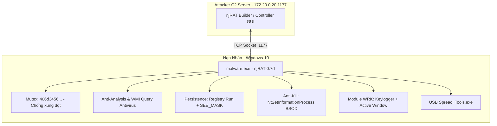

> **Mục tiêu nghiên cứu:** Khảo sát toàn diện cấu trúc nội bộ, cơ chế lẩn tránh, module gián điệp và cấu hình Command & Control (C2) của biến thể mã độc **njRAT 0.7d** hoàn toàn bằng **phương pháp phân tích tĩnh (Static Analysis)** mà không cần thực thi trực tiếp mẫu vật.  
> **Bộ công cụ sử dụng:** PeStudio · Detect It Easy / ExeinfoPE · FLOSS (FireEye Labs Obfuscated String Solver) · dnSpy (.NET Decompiler).

---

## 1. Tổng quan về Mẫu Mã Độc và Môi Trường Phân Tích

### 1.1. Họ mã độc njRAT (Bladabindi)
**njRAT** (còn được biết đến với tên gọi *Bladabindi*) là một trong những dòng Remote Access Trojan (RAT) phổ biến và nguy hiểm nhất kể từ năm 2012. Được viết trên nền tảng .NET Framework, njRAT cung cấp cho kẻ tấn công quyền kiểm soát toàn diện thiết bị nạn nhân từ xa: từ ghi lại thao tác phím (Keylogging), đánh cắp mật khẩu, chụp ảnh màn hình, quay lén webcam cho đến việc biến máy nạn nhân thành zombie để phát tán payload thứ cấp.



### 1.2. Thông tin nhận dạng mẫu phân tích (IoC sơ bộ)
Mẫu phân tích được trích xuất từ kho lưu trữ mã nguồn mở uy tín ([theZoo repository](https://github.com/ytisf/theZoo/tree/master/malware/Source/Original/NjRAT_0.7d)):

| Thuộc tính | Giá trị nhận dạng |
|---|---|
| **Tên tệp ban đầu** | `malware.exe` / `Stub.exe` |
| **Họ mã độc** | njRAT / Bladabindi (Phiên bản: `0.7d`) |
| **Định dạng tệp** | PE32 executable (GUI) Intel 80386, Mono/.Net assembly |
| **Dung lượng tệp** | `32.768 bytes` (~32 KB) |
| **Mã băm MD5** | `c35fdeebdede1d3a555e05209e61bb73` |
| **Mã băm SHA256** | `d1b368392d8143ba7038493570f34c994018cc46855918e3022085de32f6b653` |
| **Compiler / Ngôn ngữ** | Microsoft Visual Basic .NET / Framework v2.0.50727 |
| **Chỉ số Entropy** | `5.617` (Khẳng định tệp nguyên bản, không bị packed/obfuscated) |

> [!CAUTION]
> Phân tích mã độc tĩnh dù không thực thi tệp vẫn phải được tiến hành trong máy ảo chuyên dụng (FlareVM / Windows Sandbox) được cô lập mạng hoàn toàn để tránh thao tác nhầm lẫn.

---

## 2. Phân Tích Tĩnh Cơ Bản (Basic Static Analysis)

Phân tích tĩnh cơ bản là bước đầu tiên nhằm thu thập các siêu dữ liệu (metadata), đặc tính phân vùng PE, các hàm API hệ thống được import và các chuỗi ký tự mà không cần chạy chương trình.

### 2.1. Đánh giá ban đầu và Quét VirusTotal

Sử dụng PeStudio để trích xuất nhanh thông số tổng quan của tệp thực thi:


*Hình 1 — PeStudio tổng quan các đặc tính và đánh giá rủi ro ban đầu của tệp.*

Mẫu mã độc là một tệp thực thi 32-bit dạng GUI được biên dịch bằng C#/.NET. Các thuộc tính nội bộ như tên module `Stub.exe` và manifest mặc định cho thấy đây là một payload sinh ra trực tiếp từ Malware Builder mà chưa qua bước mã hóa tinh vi (crypter/packer).


*Hình 2 — Kết quả kiểm tra mức độ độc hại trên VirusTotal.*

Kết quả quét trên VirusTotal cho thấy tỷ lệ cảnh báo độc hại áp đảo: **58/71** giải pháp an ninh đánh dấu tệp là mã độc. Các nhãn phát hiện phổ biến gồm `Trojan.njRAT`, `Backdoor.Bladabindi`, `MSIL/TrojanDownloader`, xác nhận chính xác bản chất trojan điều khiển từ xa.

### 2.2. Ánh xạ năng lực qua khung MITRE ATT&CK


*Hình 3 — Phân tích hành vi tĩnh được ánh xạ theo các kỹ thuật trong ma trận MITRE ATT&CK.*

Dựa trên các chỉ báo từ PeStudio, mã độc thể hiện một phổ năng lực bao phủ nhiều giai đoạn tấn công:
- **Defense Evasion (Lẩn tránh phòng thủ)**: Thăm dò Antivirus, can thiệp Registry, che giấu tiến trình.
- **Credential Access & Collection (Thu thập dữ liệu)**: Giám sát phím gõ (Keylogging), chụp màn hình, truy cập webcam.
- **Command and Control (Giao tiếp máy chủ điều khiển)**: Tạo kết nối socket gửi dữ liệu và nhận lệnh thực thi.

### 2.3. Bóc tách PE Sections và Entropy


*Hình 4 — Chỉ số Entropy và kích thước các phân vùng PE của mẫu vật.*

Dữ liệu phân tích cấu trúc phân vùng (`sections`) chứng minh tệp **không bị đóng gói (unpacked)**:
- Mức entropy của phân vùng `.text` và `.rsrc` đều dưới **7.0** (entropy tổng là 5.617).
- Kích thước vật lý trên đĩa (`raw-size`) và kích thước trên bộ nhớ (`virtual-size`) tương đương nhau.
- Chỉ duy nhất phân vùng `.text` có quyền thực thi (`Execute`). Điều này giải thích tại sao các công cụ tĩnh có thể trích xuất trực tiếp gần như toàn bộ chuỗi ký tự và hàm API.

### 2.4. Danh sách thư viện và Bảng Import Address Table (IAT)


*Hình 5 — Danh sách các thư viện hệ thống liên kết với mẫu.*

Bảng thư viện cho thấy hai dấu hiệu kỹ thuật nổi bật:
1. `mscoree.dll`: Thư viện lõi nạp môi trường thực thi .NET (CLR Loader).
2. `avicap32.dll`: Được gọi thông qua kỹ thuật **P/Invoke**. Thư viện này quản lý các thiết bị quay video (webcam), hé lộ khả năng gián điệp hình ảnh trực tiếp.


*Hình 6 — Các hàm API cảnh báo đỏ trong bảng Import Address Table (IAT).*

PeStudio cắm cờ đỏ hàng loạt hàm API nhạy cảm:
- **Nhóm Keylogger & Theo dõi người dùng**: `GetAsyncKeyState`, `GetKeyboardState`, `GetForegroundWindow`, `MapVirtualKey`.
- **Nhóm Đa phương tiện**: `capGetDriverDescriptionA` (thăm dò phần cứng webcam).
- **Nhóm Mạng & Tải mã độc**: `connect`, `Send`, `DownloadData`, `WriteAllBytes`.
- **Nhóm Can thiệp hệ điều hành**: `NtSetInformationProcess`, `SetEnvironmentVariable`.

### 2.5. Cấu trúc Metadata .NET và Chuỗi tĩnh (Strings)


*Hình 7 — Metadata .NET Framework và các namespace sử dụng.*

Tên module nội bộ là `Stub.exe` thuộc namespace `Stub`. Ứng dụng nhắm mục tiêu .NET Framework cổ điển `v2.0.50727` nhằm tối đa hóa khả năng tương thích ngược trên hầu hết các máy Windows từ Windows 7 đến Windows 11 mà không cần cài thêm runtime mới. Các namespace được nạp gồm `System.Net`, `System.Drawing.Imaging`, `System.Security.Cryptography`, và `System.IO.Compression`.


*Hình 8 — Trích xuất các chuỗi ký tự tĩnh nghi vấn từ PeStudio.*

Trích xuất chuỗi tĩnh phát hiện:
- Địa chỉ IP khả nghi: `172.20.0.20`.
- Truy vấn WMI Unicode: `Select * From AntiVirusProduct` — một kỹ thuật kinh điển giúp mã độc kiểm tra danh sách phần mềm diệt virus đang cài trên máy.


*Hình 9 — ExeinfoPE nhận diện môi trường biên dịch VB.NET và cơ chế bảo vệ Anti-Decompiler.*

Công cụ ExeinfoPE xác nhận compiler là **VB.NET**, định danh chính xác phiên bản **NjRAT (0.7D)**, đồng thời đưa ra cảnh báo: `Anti-dnSpy + Anti-ILSpy`. Mã độc đã tích hợp sẵn cơ chế bẫy lỗi nhằm ngăn cản các nhà phân tích sử dụng công cụ dịch ngược thông dụng.

---

## 3. Phân Tích Tĩnh Nâng Cao (Advanced Static Analysis)

Nếu như phân tích tĩnh cơ bản giúp xây dựng các "giả thuyết", thì phân tích tĩnh nâng cao bằng **FLOSS** và dịch ngược mã nguồn bằng **dnSpy** sẽ chứng minh chính xác **cách thức** mã độc hiện thực hóa từng chức năng.

### 3.1. Trích xuất cấu hình C2 ẩn bằng FLOSS

Sử dụng FLOSS để giải mã các chuỗi ký tự bị che giấu:


*Hình 10 — FLOSS bóc tách toàn bộ chuỗi ký tự giải mã.*


*Hình 11 — Tham số C2 cốt lõi được làm sáng tỏ.*

Kết quả FLOSS đã giải mã thành công toàn bộ thông số cấu hình cốt lõi của chiến dịch:
- **C2 IP & Port**: `172.20.0.20:1177` (cổng 1177 là cổng mặc định khét tiếng của njRAT).
- **Campaign ID (Khóa chiến dịch)**: `Y262SUCZ4UJJ`.
- **Victim ID**: Chuỗi Base64 `dmljdGltXzAx` giải mã thành `victim_01`.
- **Khóa Mutex**: `406d3456f0ada99f8c6ea81e98985830` — dùng để ngăn ngừa việc khởi chạy trùng lặp nhiều tiến trình trên cùng một máy nạn nhân.


*Hình 12 — Chuỗi lệnh liên quan đến duy trì quyền truy cập (Persistence).*


*Hình 13 — Chuỗi lệnh can thiệp Firewall, tắt cảnh báo vùng và tự hủy.*

Các chuỗi kỹ thuật hệ thống hé lộ:
- **Khóa Registry Run**: Ghi vào `Software\Microsoft\Windows\CurrentVersion\Run` dưới tên ngụy trang `server.exe`.
- **Tắt cảnh báo tải về**: Đặt biến môi trường `SEE_MASK_NOZONECHECKS = 1` để Windows không hiện popup cảnh báo bảo mật khi mở tệp tải về từ Internet.
- **Vượt tường lửa**: Lệnh `netsh firewall add/delete allowedprogram`.
- **Cơ chế tự xóa (Self-deletion)**: Chuỗi lệnh `cmd.exe /c ping 0 -n 2 & del` để tự hủy file gốc sau khi đã thả payload vào hệ thống.


*Hình 14 — Danh sách đen các công cụ phân tích và phần mềm diệt virus bị theo dõi.*

FLOSS làm rõ danh sách "blacklist" mà njRAT liên tục rà soát:
- Tiến trình máy ảo: `VBoxService`, `VGAuthService`.
- Công cụ điều tra / gỡ lỗi: `procexp`, `processhacker`, `dnSpy`, `ILSpy`, `exeinfoPE`.
- Công cụ bắt gói mạng: `wireshark`, `apateDNS`, `Sandboxie Control`.


*Hình 15 — Cấu trúc các thông điệp trạng thái gửi về C2 Server.*

---

### 3.2. Dịch ngược mã nguồn và Bóc tách logic với dnSpy

Do tệp được biên dịch dưới dạng mã trung gian MSIL (.NET), ta sử dụng **dnSpy** để tái tạo trực tiếp mã nguồn Visual Basic/C# tương đương.

#### A. Điểm nhập (Entry Point) và Khởi tạo Mutex


*Hình 16 — Hàm Main() trong lớp A chuyển tiếp luồng thực thi sang OK.ko().*

Hàm `Main()` chỉ đóng vai trò là một lớp vỏ bọc mỏng (wrapper), lập tức chuyển toàn bộ quyền điều khiển sang hàm `OK.ko()`.


*Hình 17 — Khởi tạo Mutex và kiểm tra cờ flag3.*

Mã độc tạo đối tượng `Mutex` với khóa `OK.RG`. Nếu `flag3 == false` (nghĩa là Mutex này đã tồn tại trên hệ điều hành), nó lập tức gọi `ProjectData.EndApp()` để tự kết thúc, tránh gây chú ý do xung đột tài nguyên.

#### B. Cơ chế Kháng gỡ lỗi và Lây lan Worm qua USB


*Hình 18 — Luồng CsAntiProcess và vòng lặp lây lan ổ đĩa USB.*

- **Anti-Process**: Kích hoạt luồng `CsAntiProcess.Start()`, liên tục duyệt danh sách tiến trình chạy trên Windows; nếu thấy các tiến trình trong blacklist (như `dnSpy.exe`, `Wireshark.exe`), nó sẽ lập tức ép đóng (kill) chúng.
- **Worm Spread (Lây lan qua USB)**: Gọi `Directory.GetLogicalDrives()` để duyệt toàn bộ phân vùng ổ đĩa và thiết bị ngoại vi gắn ngoài. Sau đó tự copy chính nó thành tệp `Tools.exe` đặt tại thư mục gốc của các ổ đĩa để lây lan sang các máy tính khác.

#### C. Thăm dò Antivirus qua WMI


*Hình 19 — Hàm GetAntiVirus() truy vấn WMI namespace SecurityCenter2.*

Logic của hàm `GetAntiVirus()`:
1. Kết nối vào namespace quản lý bảo mật của Windows: `winmgmts:\\.\root\SecurityCenter2`.
2. Chạy câu truy vấn: `Select * from AntiVirusProduct`.
3. Duyệt thuộc tính `displayName` của kết quả để lấy tên Antivirus (ví dụ Windows Defender, Kaspersky).
4. Nếu không có phần mềm diệt virus nào, trả về chuỗi mặc định `"No AV"` để chuyển tiếp về máy chủ C2.

#### D. Cơ chế Chống Tắt Tiến Trình (Anti-Kill gây BSOD)


*Hình 20 — Bắt sự kiện SessionEnding và gọi NtSetInformationProcess.*

Đây là một trong những cơ chế phá hoại hung hãn nhất của njRAT:
- Mã độc đăng ký bắt sự kiện người dùng kết thúc phiên (`SessionEnding`).
- Hàm `OK.pr(1)` gọi API `NtSetInformationProcess` của `ntdll.dll` để đặt cờ `BreakOnTermination`, biến tiến trình njRAT thành **Critical System Process**.
- Nếu người dùng hoặc chuyên viên bảo mật cố tình dùng Task Manager để "End Task" tiến trình này, nhân Windows sẽ lập tức sụp đổ với lỗi **Màn hình xanh chết chóc (BSOD)**!

#### E. Cơ chế Thu nhỏ RAM và Tự bảo vệ Registry Run


*Hình 21 — Định kỳ ép giảm dung lượng RAM sử dụng và bảo vệ khóa Registry Run.*

- **Lẩn trốn Task Manager**: Cứ mỗi 5 giây, mã độc gọi `MinWorkingSet = (IntPtr)1024`, ép Windows thu hồi bộ nhớ RAM vật lý của tiến trình xuống mức tối thiểu nhằm tránh lọt vào top các ứng dụng tốn tài nguyên trên Task Manager.
- **Bảo vệ khóa Run**: Liên tục kiểm tra khóa Registry tự khởi động; nếu khóa bị xóa hoặc chỉnh sửa, mã độc lập tức tạo lại ngay lập tức.
- **Báo cáo cửa sổ**: Cứ mỗi 8 giây, lấy tiêu đề cửa sổ đang hoạt động qua `OK.ACT()` và gửi về C2 với tiền tố `"act"`.

#### F. Module Gián Điệp Bàn Phím (Keylogger) và Theo Dõi Cửa Sổ


*Hình 22 — Vòng lặp bắt phím bằng GetAsyncKeyState trong hàm WRK().*

Hàm `WRK()` (Worker) thể hiện kiến trúc Keylogger ngầm:
1. Dùng vòng lặp quét mã phím từ `0` đến `255`, gọi API `GetAsyncKeyState(num2) == -32767` để nhận diện phím vừa được nhấn xuống.
2. Gọi hàm `AV()` để gắn ngữ cảnh tiêu đề cửa sổ ứng dụng mà người dùng đang thao tác trước các ký tự phím.
3. Giới hạn bộ đệm: Nếu log phím vượt quá **20 KB** (`20 * 1024` ký tự), mã độc tự động cắt tỉa phần cũ nhất và ghi đè nội dung mới vào Registry để lưu trữ tạm thời.
4. Chèn `Thread.Sleep(1)` sau mỗi vòng quét để tối ưu CPU, giữ cho máy nạn nhân không bị giật lag.


*Hình 23 — Hàm AV() gắn nhãn bối cảnh cửa sổ ứng dụng vào log phím.*

Hàm `AV()` (Active View) gọi API `GetForegroundWindow()` và `GetWindowThreadProcessId` để lấy tên tiến trình cùng tiêu đề cửa sổ (`MainWindowTitle`). Chuỗi bối cảnh gồm thời gian, tên tiến trình và tiêu đề cửa sổ được đóng gói với ký tự phân tách đặc biệt `\u0001` trước khi gắn vào nhật ký gõ phím.

#### G. Giao thức Mạng C2 và Thực Thi Lệnh Từ Xa


*Hình 24 — Hàm connect() thiết lập socket TCP và gửi thông điệp nhận diện inf.*

Hàm `connect()` khởi tạo đối tượng `TcpClient`, kết nối trực tiếp đến IP `172.20.0.20` trên cổng `1177`. Ngay khi bắt tay thành công, nó gom thông tin hệ thống (OS, webcam, antivirus, thư mục cài đặt) qua hàm `OK.inf()`, mã hóa Base64 và truyền đi với header `"inf"`.


*Hình 25 — Hàm gửi toàn bộ log Keylogger đã lưu về máy chủ C2.*


*Hình 26 — Logic nhận mảng byte hoặc tải file qua URL rồi kích hoạt tiến trình mới.*

Hàm `Ind()` phân tách và xử lý các chỉ thị từ kẻ tấn công:
- **Lấy log bàn phím**: Đọc toàn bộ `OK.kq.Logs`, mã hóa Base64 gửi về hacker.
- **Tải và thực thi (Download & Execute)**: Nhận mảng byte nén (giải nén qua `OK.ZIP`) hoặc dùng `WebClient.DownloadData` tải payload mới từ Internet lưu vào `%TEMP%` rồi kích hoạt bằng `Process.Start()`.


*Hình 27 — Chức năng chụp màn hình nén JPEG và kiểm tra trùng lặp bằng MD5.*

- **Tối ưu băng thông**: Hàm chụp màn hình sử dụng `CopyFromScreen`, nén ảnh dưới chuẩn JPEG, sau đó **tính mã băm MD5** so sánh với ảnh cũ. Mã độc chỉ gửi ảnh về C2 nếu màn hình nạn nhân có sự thay đổi thực sự!


*Hình 28 — Lệnh cập nhật phiên bản RAT mới từ xa.*

- **Cập nhật & Tự hủy**: Tải bản update mới về thư mục `%TEMP%`, kích hoạt bản mới và gọi `OK.UNS()` để gỡ bỏ phiên bản cũ khỏi hệ thống.

---

## 4. Tổng Kết Phát Hiện và Bảng Chỉ Báo Thỏa Hiệp (IoCs)

### 4.1. Đối chiếu từ Giả thuyết (Tĩnh cơ bản) đến Khẳng định (Tĩnh nâng cao)

| Thành phần | Giả thuyết từ Phân tích tĩnh cơ bản | Khẳng định từ Phân tích tĩnh nâng cao (dnSpy & FLOSS) |
|---|---|---|
| **C2 Server** | Thấy IP `172.20.0.20` trong chuỗi tĩnh | Xác nhận IP `172.20.0.20`, cổng `1177`, Campaign ID `Y262SUCZ4UJJ`, Victim ID `victim_01` |
| **Tránh trùng lặp** | Không xác định được | Sử dụng Mutex `406d3456f0ada99f8c6ea81e98985830` |
| **Phát hiện Antivirus** | Phát hiện truy vấn WMI `AntiVirusProduct` | Hàm `GetAntiVirus()` đọc `displayName`, nếu không có trả về `"No AV"` gửi về C2 |
| **Chống tắt tiến trình** | Thấy API `NtSetInformationProcess` | Biến thành Critical Process; kích hoạt gây **BSOD** nếu bị tắt bằng Task Manager |
| **Keylogger** | Thấy `GetAsyncKeyState`, `MapVirtualKey` | Hàm `WRK()` bắt phím, gắn tiêu đề `AV()`, giới hạn bộ đệm 20KB, lưu tạm Registry |
| **Chụp màn hình** | Thấy thư viện `System.Drawing` | Chụp màn hình nén JPEG kèm **so sánh MD5** để tối ưu lưu lượng mạng |
| **Lây lan ngoại vi** | Không phát hiện được qua IAT | Module Worm tự copy thành `Tools.exe` vào thư mục gốc của tất cả ổ đĩa và USB |

---

### 4.2. Bảng Chỉ Báo Thỏa Hiệp Hoàn Chỉnh (IoCs)

Dưới đây là bộ IoCs hoàn chỉnh được trích xuất từ quá trình phân tích tĩnh, sẵn sàng phục vụ cho việc tạo SIEM Detection Rules, YARA Rules và cấu hình Firewall:

```text
[ FILE HASHES ]
MD5:    c35fdeebdede1d3a555e05209e61bb73
SHA256: d1b368392d8143ba7038493570f34c994018cc46855918e3022085de32f6b653

[ NETWORK INDICATORS ]
C2 Server IP: 172.20.0.20
C2 Port:      1177 (TCP)
Traffic Type: Plaintext / Custom protocol with delimited tokens (, [kl])

[ HOST INDICATORS ]
Mutex:              406d3456f0ada99f8c6ea81e98985830
Registry Run Key:   HKCU\Software\Microsoft\Windows\CurrentVersion\Run -> "server.exe"
Environment Var:    SEE_MASK_NOZONECHECKS = "1"
Worm File Dropped:  <DriveLetter>:\Tools.exe
Temp Executables:   %TEMP%\*.exe

[ WMI QUERIES ]
Namespace: root\SecurityCenter2
Query:     SELECT * FROM AntiVirusProduct
```

---

## 5. Kết Luận

Phương pháp **phân tích tĩnh kết hợp (Basic + Advanced Static Analysis)** đã chứng minh sức mạnh vượt trội khi giải mã hoàn toàn mẫu mã độc gián điệp **njRAT 0.7d**:
1. Không cần thực thi mẫu độc hại trong môi trường động, chúng ta vẫn bóc tách được toàn bộ cấu trúc mã nguồn, cấu hình C2, port lắng nghe và các khóa Mutex/Registry bí mật.
2. Hiểu rõ bản chất từng module giúp đội ngũ Blue Team và SOC Analyst chủ động xây dựng quy tắc phòng thủ (YARA rules, Sigma rules, IDS signatures) chính xác tuyệt đối mà không lo bỏ sót các nhánh rẽ điều kiện ẩn sâu trong code.
